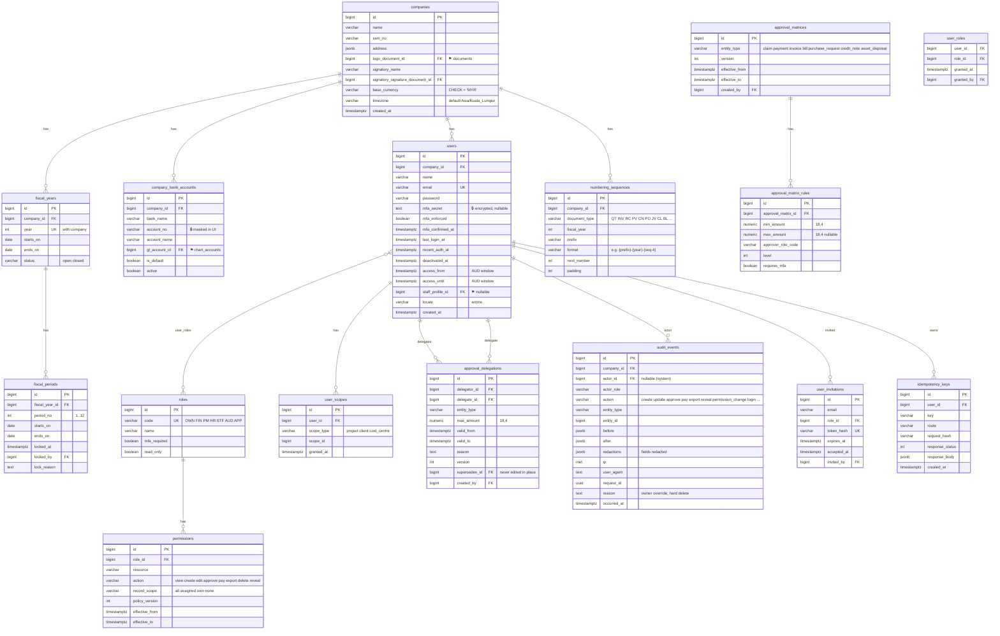
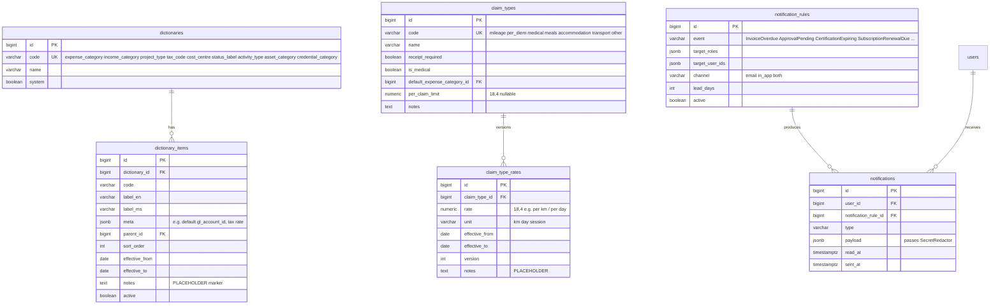
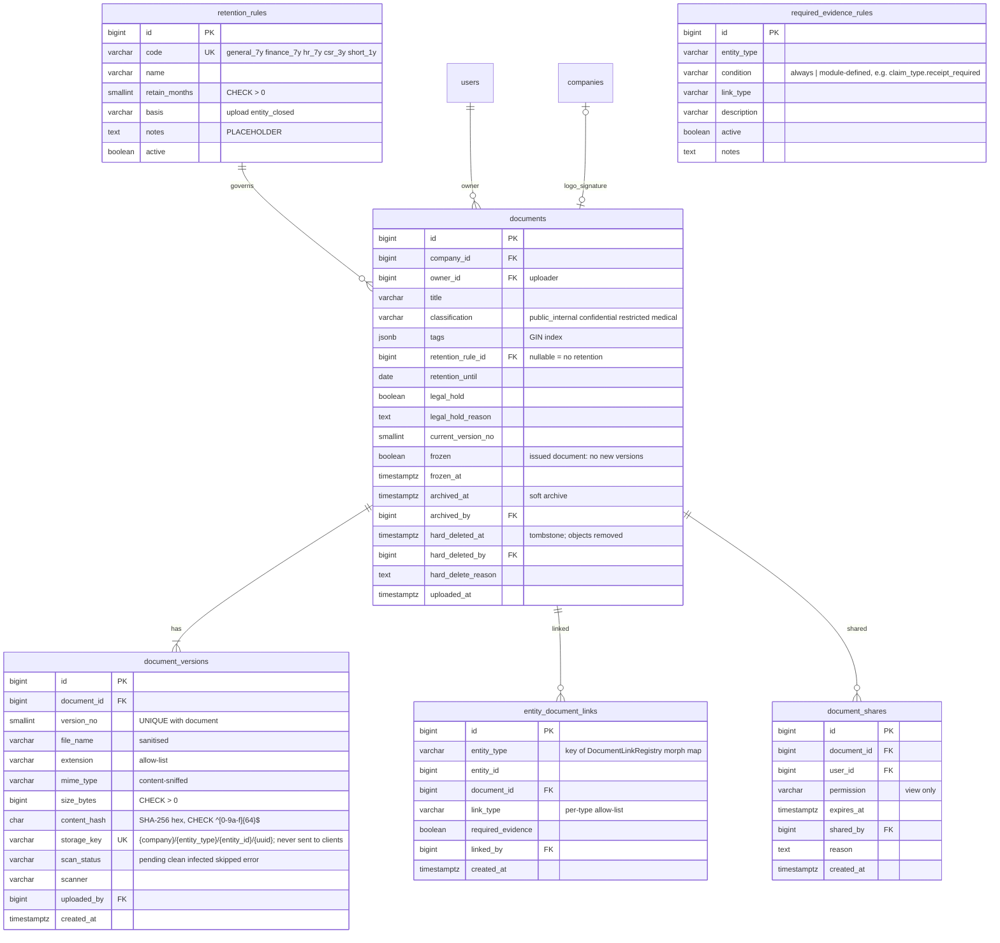
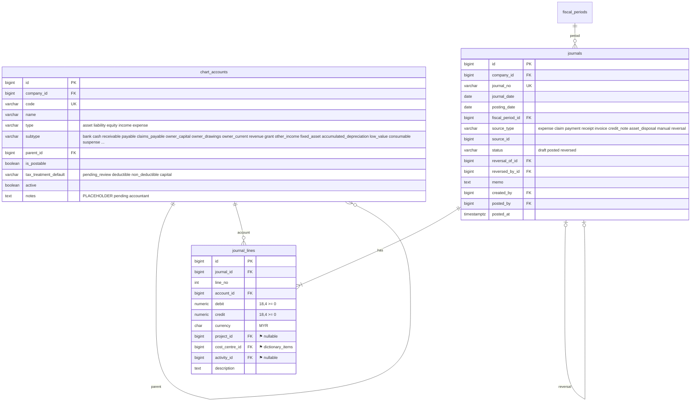
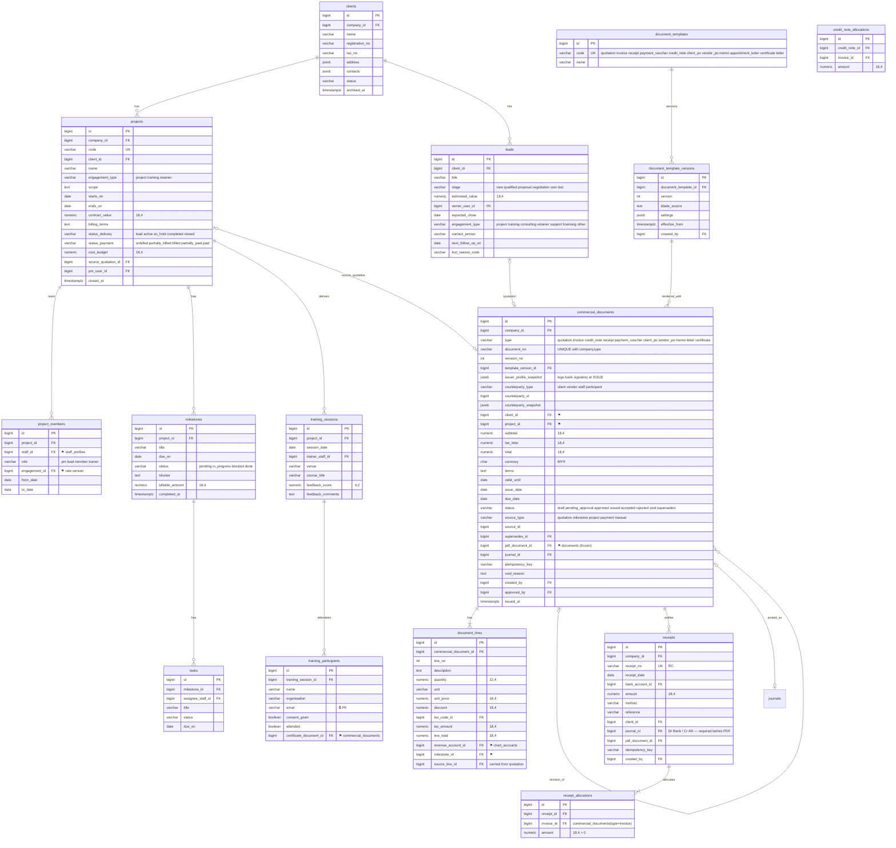
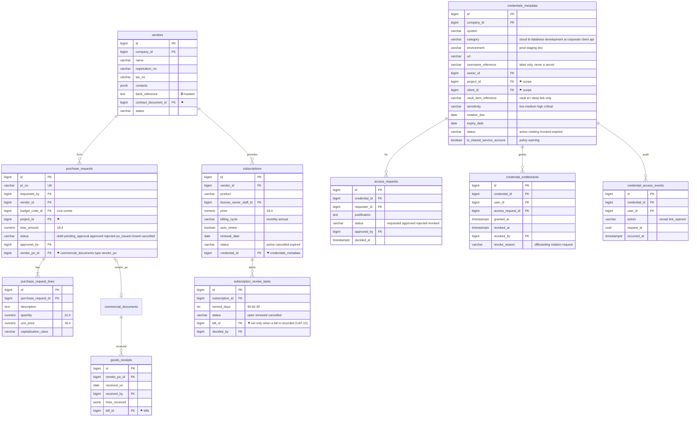
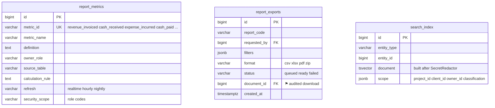

# Infernix Workspace — Data model

Conventions: PK `id BIGSERIAL`; FKs `<singular>_id BIGINT` with `ON DELETE RESTRICT` unless stated; money
`NUMERIC(18,4)`; `created_at/updated_at TIMESTAMPTZ`; soft archive via `archived_at` (G-10) — posted
financial rows are never deleted. Every status column has a `CHECK` mirroring the PHP enum. Multi-company is
anticipated: tables carry `company_id` (single row seeded now, SRS §1 "without locking future entity change").
Columns marked `⚑` are cross-module FKs (public contract); `🔒` are encrypted/restricted (see
PERMISSION_MATRIX.md). Legend below each diagram lists indexes/uniques/checks not expressible in Mermaid.

## 1. Kernel: identity, permissions, audit, numbering, settings



Legend: `UNIQUE(user_roles.user_id, role_id)`; `UNIQUE(permissions.role_id, resource, action, policy_version)`;
`UNIQUE(numbering_sequences.company_id, document_type, fiscal_year)` and allocation uses
`SELECT … FOR UPDATE`; `UNIQUE(fiscal_periods.fiscal_year_id, period_no)`; `CHECK(approval_delegations.valid_to
> valid_from)`; `UNIQUE(idempotency_keys.user_id, key, route)`; `audit_events` has an UPDATE/DELETE trigger that
RAISEs; indexes `audit_events(entity_type, entity_id)`, `(actor_id, occurred_at)`, `(request_id)`.

## 2. Dictionaries & notification rules (G-09, G-05)



Legend: `UNIQUE(dictionary_items.dictionary_id, code, effective_from)`; `CHECK(effective_to IS NULL OR
effective_to > effective_from)`; rates are **versioned** — a claim line snapshots `rate_version_id`.

## 3. Document Centre (M06) — implemented in Prompt 1b



Legend / DB rules: trigger `document_versions_immutable` — versions are never deleted and only `scan_status`
may change; trigger `document_versions_frozen_guard` — no INSERT of a version for a `frozen` document;
`UNIQUE(document_versions.document_id, version_no)`; `UNIQUE(document_versions.storage_key)`;
`UNIQUE(entity_document_links.entity_type, entity_id, document_id, link_type)`;
`UNIQUE(document_shares.document_id, user_id)`; `UNIQUE(required_evidence_rules.entity_type, condition, link_type)`;
`companies.logo_document_id` / `signatory_signature_document_id` → `documents.id`. Linkable entity types are
registered in code (`App\Kernel\Documents\DocumentLinkRegistry`): `user` (staff folder until M04 adds
`staff_profile`) and `company` today; later modules add theirs. No public visibility anywhere; bytes are only
reachable via a 5-minute signed, user-bound URL issued after the policy check (UAT-10).

## 4. Finance core (M01) — ledger



Legend / DB-level rules (CLAUDE.md rule 2): `CHECK ((debit > 0 AND credit = 0) OR (credit > 0 AND debit = 0))`;
deferred constraint trigger `journals_balanced` on `journal_lines` + `journals(status)` asserting
`SUM(debit)=SUM(credit)` when `status='posted'`; trigger `journals_immutable` blocking UPDATE/DELETE of posted
journals except the single transition `status posted→reversed` + `reversed_by_id` set (no other column may
change); trigger `journal_lines_immutable` blocking any UPDATE/DELETE when the parent journal is posted;
trigger `journals_period_open` rejecting posting into a locked `fiscal_period`; `UNIQUE(journal_no)`;
`UNIQUE(reversal_of_id)`; indexes `(fiscal_period_id, status)`, `(source_type, source_id)`,
`journal_lines(account_id, journal_id)`, `journal_lines(project_id)`.

## 5. Finance (M01) — transactions, claims, bills, payments, bank

```mermaid
erDiagram
    transactions ||--o{ transaction_lines : has
    transactions o|--o| journals : posted_as
    claims ||--|{ claim_lines : has
    claims ||--o{ claim_approvals : history
    claim_lines }o--|| claim_types : type
    claim_lines }o--o| claim_type_rates : rate_snapshot
    bills ||--|{ bill_lines : has
    bills }o--|| vendors : vendor
    payments ||--|{ payment_allocations : allocates
    payments }o--|| company_bank_accounts : from
    payments o|--o| journals : posted_as
    bank_accounts ||--o{ bank_transactions : has
    bank_transactions ||--o{ bank_matches : matched
    bank_import_profiles ||--o{ bank_transactions : imported_via

    transactions {
        bigint id PK
        bigint company_id FK
        varchar transaction_no UK
        varchar direction "inflow outflow"
        varchar inflow_type "sales_project sales_training grant other_income capital_injection loan refund"
        varchar payment_source "DIRECT_COMPANY STAFF_PAID_REIMBURSABLE OWNER_PAID"
        varchar capitalization_class "CAPITAL_ASSET LOW_VALUE_EQUIPMENT CONSUMABLE EXPENSE OWNER_DRAWING"
        date transaction_date
        date posting_date
        char currency "MYR"
        numeric gross_amount "18,4"
        numeric tax_amount "18,4"
        bigint category_id FK "dictionary_items"
        bigint account_id FK "chart_accounts"
        varchar payment_method
        varchar bank_reference
        bigint bank_account_id FK
        varchar counterparty_type "client vendor staff owner other"
        bigint counterparty_id
        bigint project_id FK "⚑"
        bigint activity_id FK "⚑"
        bigint csr_programme_id FK "⚑"
        varchar tax_treatment "pending_review deductible non_deductible capital"
        varchar status "draft submitted pending_approval approved rejected cancelled posted archived"
        bigint journal_id FK
        bigint created_by FK
        bigint approved_by FK
        timestamptz archived_at
    }
    transaction_lines {
        bigint id PK
        bigint transaction_id FK
        int line_no
        text description
        numeric amount "18,4"
        bigint category_id FK
        bigint account_id FK
        bigint tax_code_id FK
        bigint project_id FK "⚑"
        bigint cost_centre_id FK
    }
    claims {
        bigint id PK
        bigint company_id FK
        varchar claim_no UK
        bigint staff_id FK "⚑ staff_profiles / users"
        text purpose
        bigint cost_centre_id FK
        bigint project_id FK "⚑"
        bigint activity_id FK "⚑"
        varchar status "draft submitted pending_approval approved rejected finance_payable paid closed cancelled"
        numeric total_amount "18,4"
        numeric approved_amount "18,4"
        numeric paid_amount "18,4"
        bigint journal_id FK "Dr expense / Cr Staff Claims Payable"
        bigint created_by FK
        timestamptz submitted_at
        timestamptz approved_at
    }
    claim_lines {
        bigint id PK
        bigint claim_id FK
        int line_no
        bigint claim_type_id FK
        date incurred_on
        text description
        numeric amount "18,4"
        bigint category_id FK
        varchar status "pending approved rejected corrected"
        text rejection_reason
        bigint project_id FK "⚑"
        bigint activity_id FK "⚑"
        varchar origin
        varchar destination
        numeric distance_km "10,2"
        numeric rate_snapshot "18,4"
        bigint rate_version_id FK "claim_type_rates"
        text clinical_note "🔒 medical, masked for FIN"
    }
    claim_approvals {
        bigint id PK
        bigint claim_id FK
        int level
        bigint approver_id FK
        varchar decision "approved rejected"
        bigint delegation_id FK
        boolean owner_override
        text reason
        timestamptz decided_at
    }
    bills {
        bigint id PK
        bigint company_id FK
        varchar bill_no UK "internal BL-"
        bigint vendor_id FK "⚑ vendors"
        varchar vendor_invoice_no
        date bill_date
        date due_date
        numeric total_amount "18,4"
        numeric paid_amount "18,4"
        varchar status "draft pending_approval approved partially_paid paid cancelled"
        bigint purchase_order_id FK "⚑ commercial_documents vendor_po"
        bigint goods_receipt_id FK "⚑"
        bigint journal_id FK
        bigint created_by FK
        bigint approved_by FK
    }
    bill_lines {
        bigint id PK
        bigint bill_id FK
        int line_no
        text description
        numeric quantity "12,4"
        numeric unit_price "18,4"
        numeric amount "18,4"
        bigint account_id FK
        bigint category_id FK
        bigint tax_code_id FK
        bigint project_id FK "⚑"
        bigint asset_id FK "⚑ when capitalised"
        varchar capitalization_class
    }
    payments {
        bigint id PK
        bigint company_id FK
        varchar payment_no UK "PV-"
        date payment_date
        bigint bank_account_id FK "company_bank_accounts"
        varchar method "transfer cheque cash duitnow card"
        varchar reference
        varchar payee_type "vendor staff owner other"
        bigint payee_id
        numeric amount "18,4"
        varchar status "draft pending_approval approved paid posted cancelled"
        bigint journal_id FK
        bigint payment_voucher_document_id FK "⚑ commercial_documents"
        varchar idempotency_key
        bigint created_by FK
        bigint approved_by FK
        boolean owner_override
        text override_reason
    }
    payment_allocations {
        bigint id PK
        bigint payment_id FK
        varchar target_type "bill claim invoice_refund payment_batch"
        bigint target_id
        numeric amount "18,4 > 0"
    }
    bank_accounts {
        bigint id PK
        bigint company_bank_account_id FK
        numeric opening_balance "18,4"
        date opening_balance_date
    }
    bank_import_profiles {
        bigint id PK
        varchar name "Maybank CIMB ..."
        jsonb column_mapping
        varchar date_format
        boolean active
    }
    bank_transactions {
        bigint id PK
        bigint bank_account_id FK
        bigint import_profile_id FK
        varchar import_batch_id
        date txn_date
        text description
        varchar reference
        numeric amount "18,4 signed"
        numeric running_balance "18,4"
        char fingerprint "sha256 for dedupe"
        varchar status "unmatched matched excluded"
    }
    bank_matches {
        bigint id PK
        bigint bank_transaction_id FK
        bigint journal_line_id FK "bank-account journal line (P1: 1:1)"
        numeric amount "18,4"
        varchar match_type "manual auto rule"
        bigint matched_by FK
        timestamptz matched_at
    }
```



Legend: `UNIQUE(bills.vendor_id, vendor_invoice_no)` (M10-03); trigger `payment_allocations_ceiling`:
`SUM(amount) per (target_type,target_id) ≤ target balance`; `CHECK(payment_allocations.amount > 0)`;
`UNIQUE(payments.idempotency_key)`; `UNIQUE(bank_transactions.bank_account_id, fingerprint)`;
`UNIQUE(bank_matches.bank_transaction_id)` and `UNIQUE(bank_matches.journal_line_id)` (no double matching,
M01-07; as built in Prompt 2 a match points at the bank-account journal line rather than a polymorphic target);
`CHECK(transactions.capitalization_class='owner_drawing' → payment_source='direct_company')` (A-25: drawings are
company money paid to the owner); claims state machine enforced in service + `CHECK(status IN (...))`;
`claim_lines.rate_snapshot` frozen at submission; `claim_lines.clinical_note` encrypted at rest and only returned
to HR/OWN/the claimant.

**Approval history (Prompt 2).** `claim_approvals` keeps claim decisions; `approval_steps(entity_type, entity_id,
level, approver_id, decision, owner_override, delegation_id, reason, decided_at)` keeps them for bills, payments and
adjusting journals. `approval_matrices` / `approval_matrix_rules(min_amount, max_amount, level, approver_roles jsonb)`
are versioned and PLACEHOLDER (D-15). `idempotency_keys(user_id, key, route, request_hash, response_status, response_location, created_at)`, unique per user + key + route, backs the
`idempotent` middleware (§5.1).

**Vendors (minimal, Prompt 2).** `vendors(name, registration_no, tax_no, email, phone, bank_reference encrypted,
status)`; the rest of §9 procurement arrives in Prompt 5.

## 6. Commercial documents (M03) & CRM/Projects (M02)



Legend: `UNIQUE(commercial_documents.company_id, type, document_no, revision_no)`; void keeps `document_no`
(status `void`); trigger `receipt_allocations_ceiling` — `SUM(amount) per invoice ≤ invoice total − credit notes`;
`CHECK(receipts.journal_id IS NOT NULL)` before `pdf_document_id` may be set (M03-04); issued documents freeze
`pdf_document_id` (documents.frozen=true); `UNIQUE(projects.source_quotation_id)`;
`UNIQUE(project_members.project_id, staff_id, from_date)`.

**As built in Prompt 3.** `clients` (M02: name, registration_no, tax_no, email, phone, contact_person, address jsonb,
payment_terms_days, status) and a `projects` stub (code `PRJ-`, client_id, name, engagement_type, scope, contract_value,
status_delivery, status_payment, `source_quotation_id` UNIQUE FK) — `leads`, members, milestones and training come in
Prompt 4 via new migrations. `commercial_documents` additionally has `lines_snapshot jsonb` (lines + render extras as
issued), `related_document_id` (credit note → invoice), `discount_total`, `settlement_status` (unpaid | partially_paid |
paid), `amount_received`, `amount_credited`, `current_level`, `void_pdf_document_id`, `reversal_journal_id`,
`internal_notes`, `issued_by`, `client_response_at`; `document_no` is allocated at issue and is unique per
(company, type, number, revision). `document_template_versions` store `view_name` + `settings` (no user-supplied Blade,
A-36). `document_lines` add `tax_rate` (snapshot) and `net_amount`. `receipts.journal_id` is NOT NULL; receipts carry
`unapplied_amount`, `status` (posted | void), `reversal_journal_id`; allocations carry `voided_at` instead of ever being
deleted.

DB rules: `commercial_documents_immutable` (issued rows: only status/settlement/PDF-once/void fields change, legal status
transitions only; issued rows never deleted), `document_lines_draft_only`, `document_template_versions_append_only`,
`receipts_immutable`, `invoice_allocation_ceiling` (receipts + credits ≤ invoice total, invoice must be issued),
`allocations_no_delete`; CHECK `amount_received + amount_credited ≤ total`.

M11: `report_metrics(metric_id UK, metric_name, definition, owner_role, source, calculation_rule, refresh_time,
security_scope, notes)` and `exports(user_id, report_key, format, filters jsonb, row_count, document_id)`.
Kernel: `notifications` (Laravel database channel) and `notification_dispatches(notification_rule_id, user_id,
dedupe_key, dispatched_on)` UNIQUE (rule, user, key).

## 7. HR (M04)

```mermaid
erDiagram
    staff_profiles ||--o{ engagements : rate_versions
    staff_profiles ||--|| staff_bank_details : restricted
    staff_profiles ||--o{ timesheets : submits
    timesheets ||--|{ timesheet_entries : has
    projects ||--o{ timesheet_entries : against
    payment_batches ||--|{ payment_batch_lines : has
    timesheets ||--o{ payment_batch_lines : paid_by
    staff_profiles ||--o{ memos : receives

    staff_profiles {
        bigint id PK
        bigint company_id FK
        bigint user_id FK "nullable"
        varchar staff_no UK
        varchar engagement_type "employee part_time freelancer intern"
        varchar legal_name
        varchar id_type "nric passport"
        text id_number "🔒 encrypted, masked"
        jsonb contact
        date joined_on
        date ended_on
        varchar status "active inactive"
        varchar classification "employee contractor"
        timestamptz classification_reviewed_at
    }
    staff_bank_details {
        bigint id PK
        bigint staff_profile_id FK UK
        text bank_name "🔒"
        text account_no "🔒 encrypted"
        text account_name "🔒"
        bigint updated_by FK
    }
    engagements {
        bigint id PK
        bigint staff_profile_id FK
        varchar rate_type "hourly daily per_session fixed"
        numeric rate_amount "18,4"
        date effective_from
        date effective_to
        int version
        bigint agreement_document_id FK "⚑"
        boolean locked "true once used"
    }
    timesheets {
        bigint id PK
        bigint staff_profile_id FK
        date period_start
        date period_end
        varchar status "draft submitted verified rejected calculated approved paid"
        bigint verified_by FK
        numeric total_hours "8,2"
        numeric calculated_amount "18,4"
        bigint engagement_id FK "locked rate version"
    }
    timesheet_entries {
        bigint id PK
        bigint timesheet_id FK
        bigint project_id FK "must be assigned (UAT-07)"
        date work_date
        numeric hours "5,2"
        text description
        bigint task_id FK
        boolean exception_granted
        bigint exception_granted_by FK
    }
    payment_batches {
        bigint id PK
        varchar batch_no UK
        date period_end
        varchar status "draft pending_approval approved paid"
        numeric total_amount "18,4"
        bigint created_by FK
        bigint approved_by FK
        bigint payment_id FK "⚑ payments"
        bigint handoff_document_id FK "payroll CSV"
    }
    payment_batch_lines {
        bigint id PK
        bigint payment_batch_id FK
        bigint timesheet_id FK
        bigint staff_profile_id FK
        numeric amount "18,4"
        bigint contractor_invoice_document_id FK "required when classification=contractor"
    }
    memos {
        bigint id PK
        bigint staff_profile_id FK
        bigint commercial_document_id FK "⚑ generated memo"
        timestamptz read_at
    }
```

Legend: `UNIQUE(engagements.staff_profile_id, version)`; trigger blocks UPDATE of `engagements` where
`locked=true`; `CHECK(timesheet_entries.hours > 0 AND hours <= 24)`; `UNIQUE(timesheets.staff_profile_id,
period_start)`.

**As built in Prompt 4.** HR: `staff_profiles` (staff_no ST-, engagement_type, classification + reviewed_at/by, id_number
encrypted + id_last4, contact, status), `staff_bank_details` (all encrypted + account_last4), `engagements` (versioned,
`locked_at`; trigger `engagements_locked`), `timesheets` (rate_snapshot, calculated_amount frozen by
`timesheets_calculation_frozen`; status draft→submitted→verified→calculated→batched→approved→paid, rejected),
`timesheet_entries` (editable only in draft/rejected; `exception_granted`), `payment_batches` (PB-, approval level,
accrual/payout journal ids, voucher_no PV-, handoff document) + `payment_batch_lines` (UNIQUE timesheet_id, frozen once
submitted), `staff_memos`. M02: `leads` (stage, quotation_id UNIQUE), `projects` + billing_terms, cost_budget, lead_id,
closeout_checklist, description; `project_members` (user_id copied for scoping, engagement_id), `milestones` (blocker
required when blocked, billable_amount), `tasks`, `training_sessions`, `training_participants` (email encrypted,
consent_given, certificate_document_id). M03: `commercial_documents` + external_ref, subject, body, verification_token
(UNIQUE, required for certificates), effective_date; types add `appointment_letter`.

## 8. Assets (M05), Activities (M07), CSR (M08), Certifications (M09)

```mermaid
erDiagram
    assets ||--o{ asset_assignments : custody
    assets ||--o{ asset_maintenance : log
    assets o|--o| asset_disposals : disposed
    assets ||--o{ depreciation_schedules : schedule
    activities ||--o{ activity_attendees : has
    activities ||--o{ itinerary_items : has
    csr_programmes ||--o{ csr_volunteers : has
    csr_programmes ||--o{ csr_in_kind_contributions : has
    certifications ||--o{ renewal_schedules : reminders
    memberships ||--o{ renewal_schedules : reminders

    assets {
        bigint id PK
        bigint company_id FK
        varchar asset_no UK
        bigint purchase_transaction_id FK "⚑ transactions OR bill_lines — no second expense"
        bigint purchase_bill_line_id FK "⚑"
        varchar name
        bigint category_id FK
        varchar serial_no
        date purchase_date
        numeric cost "18,4"
        varchar capitalization_class "CAPITAL_ASSET LOW_VALUE_EQUIPMENT"
        bigint custodian_staff_id FK
        varchar location
        varchar status "registered assigned in_repair disposed"
        date warranty_expiry
        bigint gl_asset_account_id FK
    }
    asset_assignments {
        bigint id PK
        bigint asset_id FK
        bigint staff_id FK
        varchar location
        timestamptz assigned_at
        timestamptz returned_at
        bigint handover_document_id FK
    }
    asset_maintenance {
        bigint id PK
        bigint asset_id FK
        date serviced_on
        text description
        bigint expense_transaction_id FK "⚑ link, no copy"
    }
    asset_disposals {
        bigint id PK
        bigint asset_id FK
        date disposed_on
        varchar method "sold scrapped donated"
        numeric proceeds "18,4"
        bigint proceeds_receipt_id FK "⚑"
        bigint journal_id FK "⚑ via PostingService"
        bigint approved_by FK
    }
    depreciation_schedules {
        bigint id PK
        bigint asset_id FK
        varchar method "straight_line"
        int useful_life_months
        numeric residual_value "18,4"
        date period_start
        numeric amount "18,4"
        bigint journal_id FK "nullable; posting behind feature flag"
    }
    activities {
        bigint id PK
        bigint company_id FK
        varchar type "event site_visit conference trip training_delivery"
        varchar name
        varchar location
        date date_start
        date date_end
        bigint organizer_user_id FK
        text purpose
        bigint project_id FK "⚑"
        bigint client_id FK "⚑"
        numeric budget "18,4"
        varchar status
        bigint report_document_id FK
    }
    activity_attendees {
        bigint id PK
        bigint activity_id FK
        bigint staff_id FK
        varchar external_name
    }
    itinerary_items {
        bigint id PK
        bigint activity_id FK
        timestamptz starts_at
        varchar kind "flight hotel transport meeting session"
        text details
    }
    csr_programmes {
        bigint id PK
        bigint company_id FK
        varchar name
        text objectives
        varchar partner
        varchar sponsor
        varchar venue
        date date
        varchar beneficiary_group
        int target_count
        int actual_count
        numeric budget "18,4"
        bigint activity_id FK "⚑ finance linkage by activity"
        varchar status
    }
    csr_volunteers {
        bigint id PK
        bigint csr_programme_id FK
        bigint staff_id FK
        varchar external_name
        numeric hours "5,2"
    }
    csr_in_kind_contributions {
        bigint id PK
        bigint csr_programme_id FK
        varchar item
        numeric estimated_value "18,4 NOT cash"
        varchar source
    }
    certifications {
        bigint id PK
        varchar holder_type "staff company"
        bigint holder_id
        varchar issuer
        varchar name
        varchar credential_no
        date issue_date
        date expiry_date
        boolean no_expiry
        varchar verification_url
        varchar status "valid expiring expired revoked"
        bigint document_id FK "⚑"
    }
    memberships {
        bigint id PK
        varchar holder_type
        bigint holder_id
        varchar organisation
        varchar membership_no
        date cycle_start
        date cycle_end
        varchar status
    }
    renewal_schedules {
        bigint id PK
        varchar renewable_type "certification membership subscription credential_rotation"
        bigint renewable_id
        date due_on
        int remind_days "90 60 30"
        timestamptz reminded_at
        bigint renewal_expense_transaction_id FK "⚑ link only"
    }
```



Legend: `CHECK(assets.purchase_transaction_id IS NOT NULL OR purchase_bill_line_id IS NOT NULL)`;
`UNIQUE(asset_assignments.asset_id) WHERE returned_at IS NULL`; in-kind values are excluded from all cash
reports (M08-03); `UNIQUE(renewal_schedules.renewable_type, renewable_id, remind_days)`.

**As built in Prompt 5 (M05/M07/M08/M09).**
- M05: `asset_categories` (default class, useful life, residual % — PLACEHOLDER), `asset_candidates` (posted CAPITAL_ASSET purchase lines
  awaiting registration; UNIQUE (source_type, source_line_id)), `assets` (AST-; `acquisition_type` purchase|opening_balance|donation;
  purchase ⇒ `purchase_source_type` + `purchase_transaction_id` XOR `purchase_bill_id` + `purchase_line_id` (CHECK); trigger
  `assets_purchase_ceiling`: Σ cost per purchase line ≤ line amount and the source must be posted/approved CAPITAL_ASSET),
  `asset_assignments` (one open per asset — partial UNIQUE), `asset_maintenance` (repair cost via `finance_links`),
  `asset_disposals` (DSP-; matrix approval; cost/accumulated/NBV snapshots; one live disposal per asset), `asset_depreciation`
  (monthly schedule; rows with `journal_id` immutable — trigger).
- M07: `activities` (ACT-; type event|site_visit|conference|trip|training_delivery|csr; budget; post-event report), `activity_attendees`,
  `activity_itinerary_items` (estimates only). Actuals = booked `claim_lines` / `transaction_lines` / `bill_lines` with `activity_id`.
- M08: `csr_programmes` (CSR-; `activity_id` UNIQUE = finance anchor), `csr_volunteers`, `csr_in_kind_contributions` (estimated value,
  never cash), `csr_evidence` (document_id UNIQUE, consent flags; CHECK publishable ⇒ consent when people identifiable).
- M09: `certifications` (holder staff|company CHECK; no_expiry XOR expiry_date CHECK), `memberships` (annual period), `renewals`
  (one row per cycle; UNIQUE (renewable_type, renewable_id, due_date); fee via `finance_links`).
- Finance hooks (M01 migration 2026_01_07_000001): `transaction_lines.activity_id`, `bill_lines.activity_id`, `bills.vendor_po_id`,
  `bills.goods_receipt_id`, UNIQUE (vendor_id, lower(btrim(vendor_invoice_no))), `finance_links` (entity_type, entity_id, source_type
  transaction|bill|claim|payment, source_id, purpose; UNIQUE per entity+source).

## 9. Procurement (M10) & Credentials (M13)



Legend: `UNIQUE(bills.vendor_id, vendor_invoice_no)` (see §5); `credentials_metadata` has **no** secret
column by design and a DB `CHECK (vault_item_reference !~* '(password|secret|token)=')` as a cheap guard;
`UNIQUE(credential_entitlements.credential_id, user_id) WHERE revoked_at IS NULL`;
`subscription_review_tasks` never writes to finance tables (UAT-12).

**As built in Prompt 5 (M10/M13 + kernel search).**
- M10: `vendors` + category, email, phone, address, payment_terms_days, notes; `purchase_requests` (PR-; matrix approval; `vendor_po_id`
  once ordered) + `purchase_request_lines`; `goods_receipts` (GRN-; against an issued vendor PO) + `goods_receipt_lines` (never above the
  ordered quantity — service); `subscriptions` (vendor, product, licence owner, seats, price, cycle, auto_renew, renewal_date, status) +
  `subscription_reviews` (UNIQUE (subscription_id, renewal_date); open → renew|cancel).
- M13: `credentials_metadata` (CRD-; category / environment / sensitivity CHECKs; vault_provider + vault_item_reference; owner; project /
  client scope with CHECK client credentials ⇒ client_id; shared service account ⇒ justification; **no secret column**),
  `credential_access_requests` (CHECK decided_by ≠ requester), `credential_entitlements` (one active per user+credential — partial
  UNIQUE; revoke fields; vault_sync), `credential_rotations`, `jml_checklists` (joiner|mover|leaver, items JSON).
- Kernel: `search_index` (entity_type, entity_id UNIQUE, title, body — redacted on write; GIN text index).

## 10. Reporting (M11)



Schema `reporting` (P4, `2026_01_08_000002`): read-only views `revenue_vs_cash`, `project_margin`,
`outstanding_receivables`, `expenses_by_category`, `claims_outstanding`, `asset_register`,
`tax_pack_journal_lines`, `credential_renewal` — no NRIC / bank / MFA / clinical / credential-reference / audit
JSON columns; NOLOGIN role `infernix_reporting_read` has SELECT on these views only (docs/POWER_BI.md).

## 11. Prompt 6 (P4) additions

| Table | Purpose | Key rules |
|---|---|---|
| `bank_import_profiles` (+ `template_key`, `bank_name`, `delimiter`, `skip_rows`) | per-bank CSV layout | seeded generic / maybank / cimb (PLACEHOLDER) |
| `bank_match_rules` | auto-match rules: priority, direction, amount and date windows, description / reference regex | only a unique candidate is matched |
| `bank_matches` (+ `match_group`, `rule_id`; UNIQUE bank_transaction_id + journal_line_id) | N:M matching | trigger `bank_matches_ceiling`: matched sum ≤ absolute amount on both sides; bank status `partial` |
| `report_schedules` | scheduled report emails (report_key, format, frequency, day, recipient_ids, active, last_run_at) | executed as each recipient; link only |
| `einvoice_outbox` | MyInvois submission queue (invoice_id UNIQUE, idempotency_key UNIQUE, gateway, payload, status, attempts, next_attempt_at, submitted_at, accepted_at, external_uuid, long_id, last_error) | `FOR UPDATE SKIP LOCKED`; backoff |
| `einvoice_events` | append-only gateway event log (outbox_id, event, detail) | trigger blocks UPDATE / DELETE |
| `backup_runs` | backup / restore-test / prune history (kind, status, object_key, size_bytes, details, source_run_id, pruned, triggered_by, started_at, finished_at, error) | shown on Admin → Backups |
| `users.locale` CHECK (`en`,`ms`) | BM / EN preference | `SetLocale` middleware |
| `credential_entitlements.vault_sync` widened to varchar(20) | `not_applicable` fits (`2026_01_08_000008`) | |
| `approval_matrices` / `approval_matrix_rules` (unchanged schema) | now edited in the UI by publishing version n+1 | old versions closed via `effective_to`, never edited |
| indexes `2026_01_08_000006` | hot list / report paths for the 50k-row benchmark | docs/PERFORMANCE.md |

`search_index` now also holds `project`, `client`, `staff` (staff no, name, position — never identity or bank
data), `quotation`, `invoice`, `credit_note`, `vendor_po`; every hit is re-checked against the record policy.
